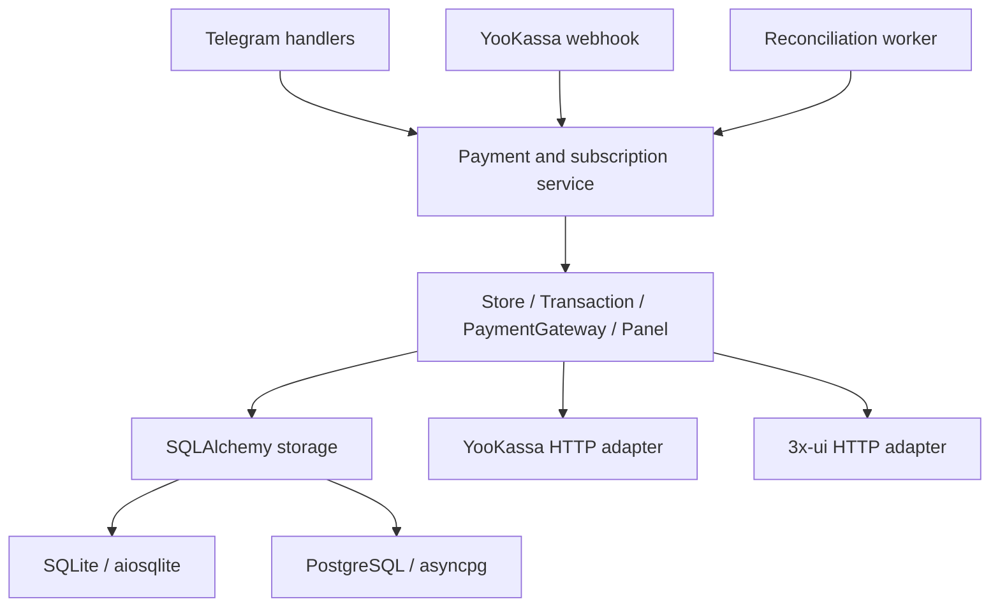

# Архитектура VPN_bot

Это новая реализация подтверждённых требований, созданная 11 октября 2026 поверх
опубликованного main. Архитектура погибшей VM не восстановлена.

## Слои и зависимости

`domain.py` содержит значения и ошибки без зависимостей от инфраструктуры.
`ports.py` определяет операции транзакции, хранилища и внешних сервисов.
`services.py` задаёт сценарии покупки, подтверждения, пробного доступа и восстановления.
Транспорт не выполняет SQL и не вызывает панель напрямую.
`app.py` создаёт зависимости; импорт модулей не создаёт Bot, HTTP-сессии и подключения.

## Данные

- `vpn_accounts`: Telegram ID и revision для сериализации действий пользователя.
  Аккаунт существует независимо от VPN: первая покупка не требует пробной подписки.
- `vpn_orders`: UUID заказа/ключ ЮKassa, уникальный ключ пользовательского запроса,
  владелец, копейки, снимок тарифа/return URL, remote payment ID, статус,
  `applied`, `legacy`, `notified`. `payment_id` уникален и может отсутствовать до ответа API.
- `vpn_subscriptions`: сохранённые UUID, email, short_id, sub_id, port,
  абсолютное время окончания в миллисекундах UTC, лимит устройств, enabled и synced.
- `vpn_schema`: версия схемы. Старые users/payments/trial_users сохраняются только
  как источник миграции; новый runtime их не читает и не изменяет.

SQLAlchemy Core и async engine обслуживают обе БД. Диалектные операции (upsert аккаунта,
SQLite PRAGMA/BEGIN) находятся только в `storage.py`. Бизнес-логика работает с портами.
Смена DATABASE_URL переключает backend; перенос уже накопленных данных требует отдельной
операции экспорта/импорта с проверкой количества строк и связей.

## Транзакции и оплата

1. В транзакции пользователя сохраняется заказ `creating`. Telegram request key
   включает владельца, чат, message ID и тариф; новый экран покупки — новый заказ.
2. После commit вызывается создание в ЮKassa; повтор использует UUID заказа и тот же
   payload. Привязка ответа тоже сериализована. Внешний вызов ограничен 20 секундами.
   При потерянном ответе reservation остаётся. После 23 часов неподтверждённый заказ
   переводится в `review`, чтобы не выйти за 24-часовое окно идемпотентности API.
3. Callback проверяет владельца до HTTP. Webhook берёт только payment ID и повторно
   получает объект из API магазина. Сверяются ID, сумма, RUB, shop ID, test-флаг,
   Telegram ID и order ID; для импортированного legacy order ID не требовался старым кодом.
   `succeeded` должен иметь `paid=true`; `waiting_for_capture` доступа не даёт.
4. Одна DB-транзакция проверяет `applied`, меняет окончание подписки на
   `max(expiry, now) + purchased_days`, записывает тарифный лимит, `synced=false`
   и `applied=true`. Rollback отменяет всё начисление. Повтор не прибавляет дни.
   Терминальные статусы не откатываются по запоздалому pending-ответу.
5. Отдельная транзакция применяет **абсолютные** expiry/limit к панели и ставит synced.
   Сбой оставляет оплаченный заказ и желаемую подписку для фонового повтора после рестарта.
   При неизвестном результате создания inbound повтор ищет сохранённый UUID в панели.

Уникальные ключи и update строки аккаунта сериализуют пользователя между процессами
на PostgreSQL. На SQLite BEGIN IMMEDIATE сериализует записи (в этой реализации также
чтения); busy_timeout=30 секунд. Ошибки БД не маскируются как «пользователь не найден».

Вызовы создания платежа/панели пока выполняются при удержании блокировки аккаунта.
Это простой выбор для небольшой установки: он исключает параллельное применение
разных сроков. На SQLite долгий HTTP временно задерживает других пользователей.
Для большего потока нужен отдельный worker с устойчивой очередью и блокировками,
а не снятие транзакции вокруг вызова без замены протокола синхронизации.

## Внешние эффекты

3x-ui не участвует в DB-транзакции. Гарантия единственного начисления относится к БД;
в панели используются повторяемые абсолютные значения и чтение результата. Позднее
завершение удалённого запроса после локального timeout и ручные изменения панели требуют
сверки состояния; распределённая exactly-once гарантия не заявляется.

Адаптер сохраняет модель отдельного inbound на пользователя. Для продления обновляет
inbound и client классического API, затем проверяет expiry, limitIp, enable и subId.
Общий inbound с несколькими клиентами и конфликт UUID/email отклоняются.
Тарифный лимит передаётся как limitIp; фактическое ограничение зависит от настройки панели.

Worker сначала сверяет незавершённые заказы, затем несинхронизированные подписки,
затем уведомления; пауза между проходами 30 секунд. Ошибка отдельного заказа не
прерывает проход. Уведомления доставляются с повтором: сбой после отправки, но до
DB commit может повторить сообщение, но не начисление дней. Здесь нет автосписаний.

## HTTP и жизненный цикл

Telegram webhook проверяет секретный заголовок; обработка идёт до HTTP-ответа,
чтобы не подтверждать приём обновления раньше выполнения handler.
Webhook ЮKassa возвращает 200 после обработки, 503 при временной ошибке/раннем
уведомлении до привязки ID, 400 при несовпадении оплаты. `review` сохраняется для
ручной сверки, повтор уведомления не снимает блокировку.

У короткой ссылки bearer-семантика: владельцем доступа считается знающий случайный
short_id. Прокси проверяет срок, enabled, synced, использует сохранённый sub_id,
не следует редиректам и ограничивает размер ответа. Access log приложения выключен,
чтобы ссылки не попадали в него; reverse proxy также должен исключить `/sub/` из логов.

Раздельные HTTP-сессии используются для магазина, панели и подписок. Сессии и engine
закрываются при завершении и ошибке startup; worker отменяется. При остановке webhook
Telegram не удаляется, чтобы перезапуск не создавал разрыв доставки.

## Первичные источники контрактов

- [ЮKassa: идемпотентность и формат API](https://yookassa.ru/developers/using-api/interaction-format).
- [ЮKassa: уведомления и проверка статуса](https://yookassa.ru/developers/using-api/webhooks).
- [ЮKassa: API платежей](https://yookassa.ru/developers/api).
- [SQLAlchemy: asyncio](https://docs.sqlalchemy.org/en/20/orm/extensions/asyncio.html)
  и [транзакции SQLite](https://docs.sqlalchemy.org/en/20/dialects/sqlite.html).
- [3x-ui: классический API](https://github.com/MHSanaei/3x-ui/wiki/Configuration/ad143e31125e0a939efbf11e2b3c66595384f2b4).
